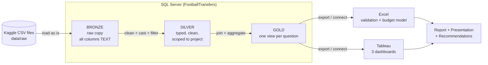
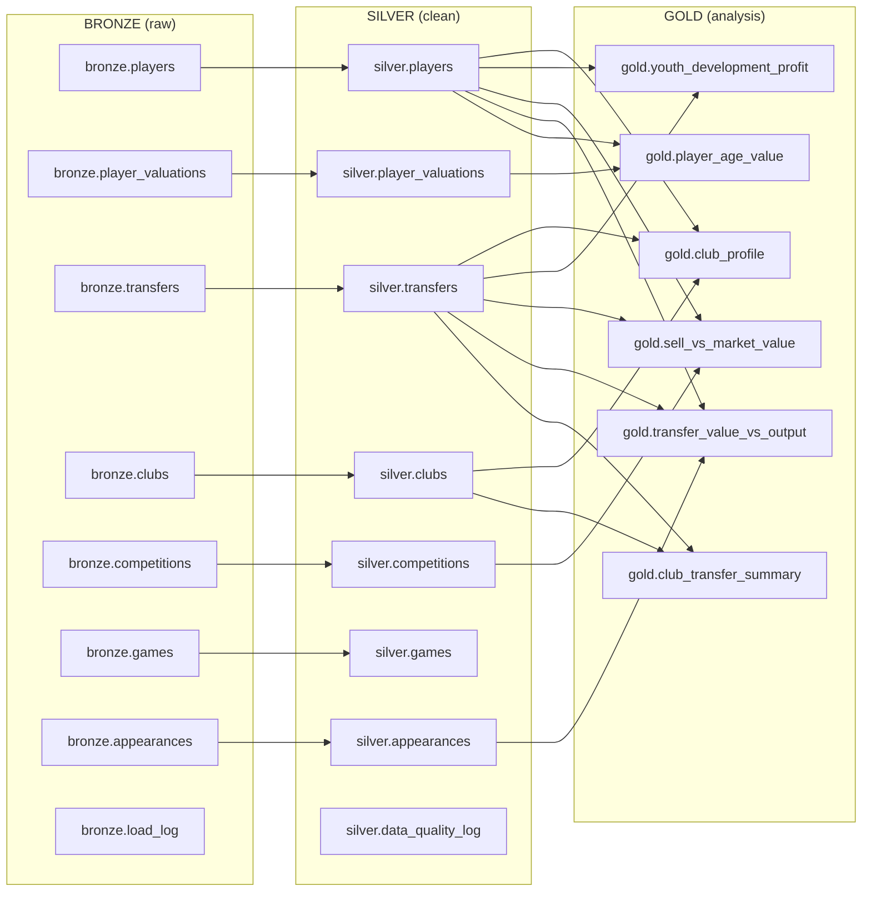
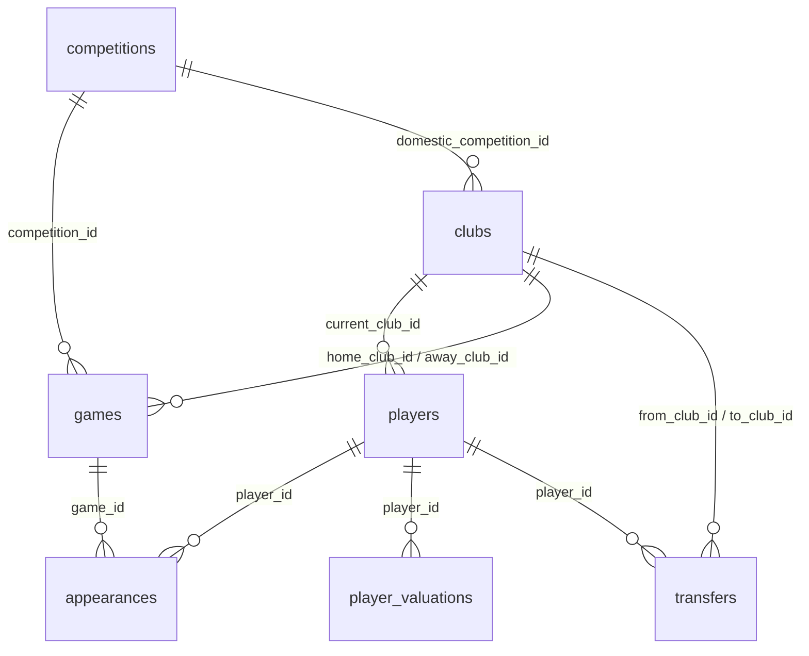
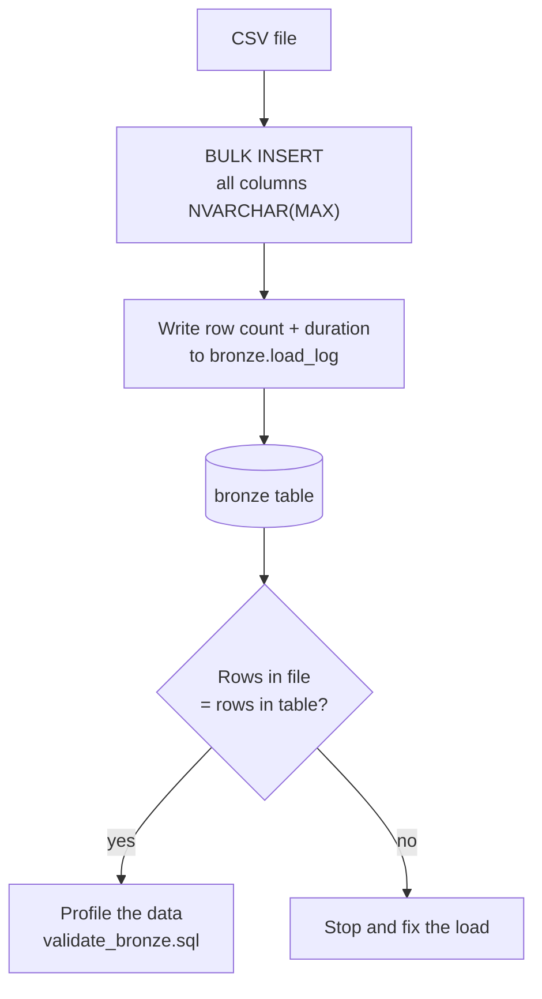
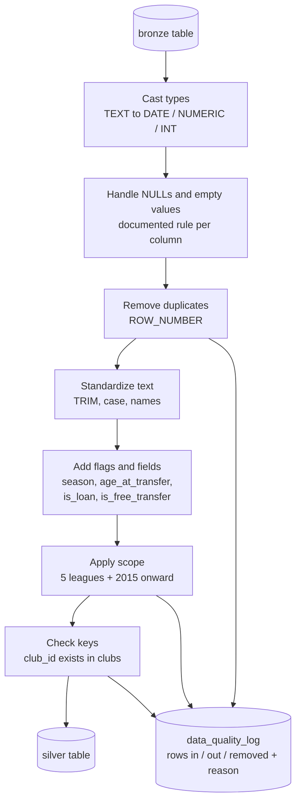
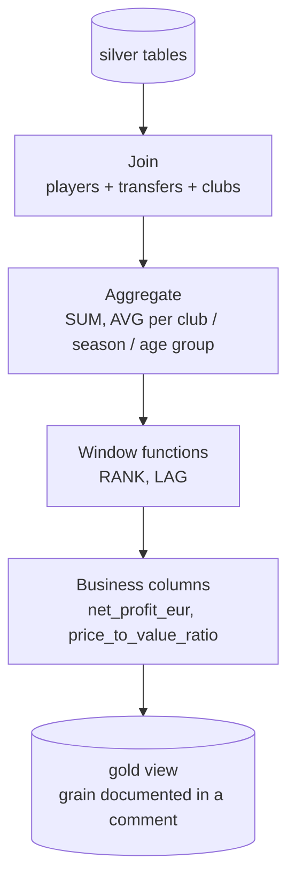
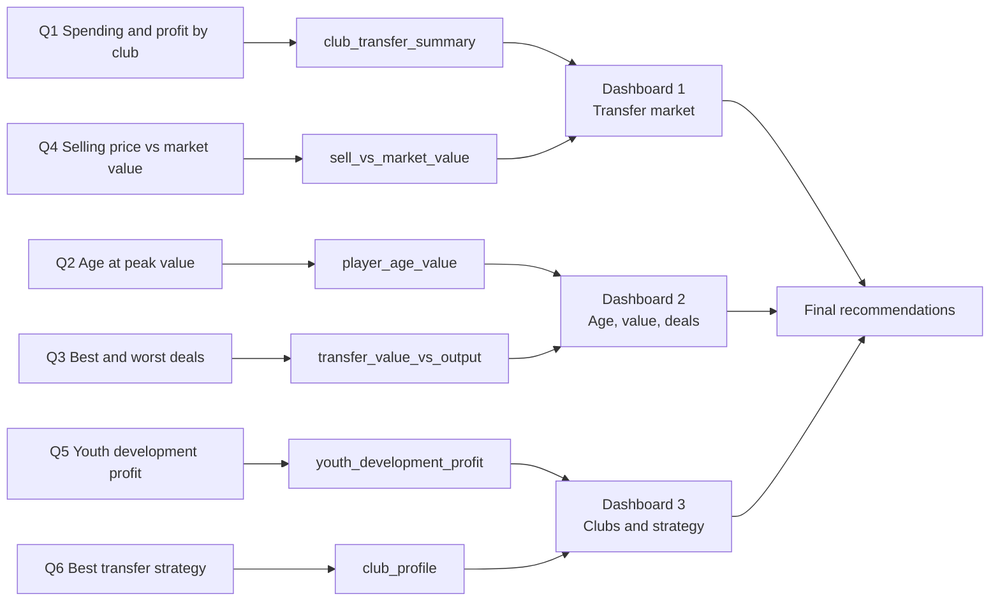
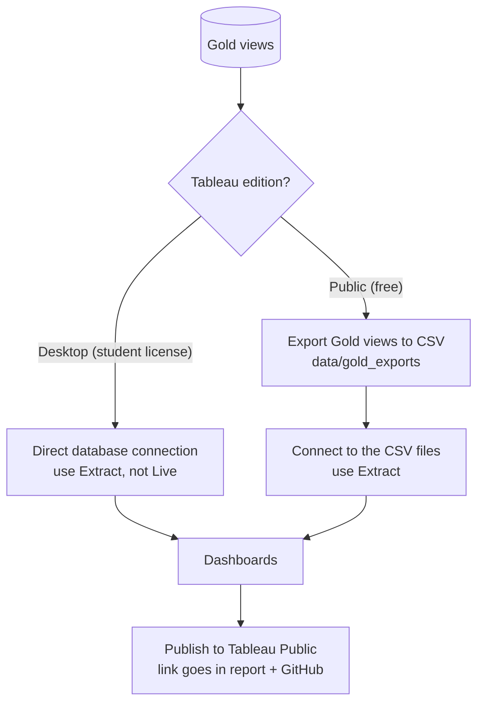

# Data Architecture: Medallion (Bronze / Silver / Gold)

> The diagrams below are written in Mermaid. They render automatically on GitHub and in most Markdown viewers (VS Code with the Mermaid extension, Notion, Obsidian). To get an image for the report, paste a diagram into https://mermaid.live and export PNG or SVG.

## 1. Data source

- **Dataset:** Transfermarkt Dataset (Kaggle: `davidcariboo/player-scores`)
- **Version note:** the maintainer announced that updates are paused and the data is current to **6 July 2026**. If you downloaded the files after that, you hold the latest available snapshot.
- **Download date:** `____-__-__` (fill in, and keep the same files for the whole project)

## 2. End-to-end flow



## 3. Layer contracts

|                    | Bronze                                       | Silver                          | Gold                          |
| ------------------ | -------------------------------------------- | ------------------------------- | ----------------------------- |
| Purpose            | Safety copy of the source                    | Trustworthy clean data          | Answers to business questions |
| Column types       | all NVARCHAR(MAX)                            | real types (DATE, NUMERIC, INT) | real types                    |
| Filtering          | none                                         | project scope applied here      | already scoped                |
| Who reads it       | Silver only                                  | Gold only                       | Excel, Tableau                |
| Allowed to change? | never                                        | when cleaning rules change      | when questions change         |
| Check              | row count = file row count (bronze.load_log) | `data_quality_log`              | numbers match Excel           |

## 4. Tables per layer



## 5. Relationships between tables (ERD)

Based on the relationships documented by the dataset maintainer. The `transfers` links are the standard ones, but **check the exact column names against your own file** (for example `from_club_id` and `to_club_id`) before writing joins.



## 6. What happens inside each layer

### Bronze



### Silver



### Gold



## 7. From questions to dashboards



## 8. How Tableau connects



Tableau reads **Gold only**. If you need a new calculation, create it as a Gold view in SQL instead of using Custom SQL inside Tableau.

## 9. Project structure

```
graduation-project/
├── data/
│   ├── raw/                     # the CSV files (never edited)
│   └── gold_exports/            # Gold views exported for Tableau Public
├── sql/
│   ├── 00_explore/
│   ├── 01_bronze/
│   │   ├── 00_init_database.sql
│   │   ├── ddl_bronze.sql
│   │   ├── proc_load_bronze.sql
│   │   ├── validate_bronze.sql
│   │   └── bronze_optional_tables.sql
│   ├── 02_silver/
│   ├── 03_gold/
│   └── 04_analysis/
├── excel/
├── tableau/
├── docs/
│   ├── 01_data_architecture.md
│   ├── erd/
│   └── data_dictionary/
└── README.md
```

## 10. Bronze profiling checklist (answer these before writing Silver)

- Date range of `transfers`, `player_valuations`, `games`.
- Which leagues exist in `competitions` (decides the project scope).
- What `0`, empty, and NULL mean in the transfer fee column (loan, free transfer, or unknown).
- How many `club_id` values in `transfers` do not exist in `clubs`.
- Whether a player can appear twice for the same transfer (duplicates).
- Empty cells are loaded as NULL (KEEPNULLS), but still use `NULLIF(LTRIM(RTRIM(col)), '')` in Silver to be safe.
- Text values with stray spaces exist (for example `city_of_birth` = `Opole  `): trim in Silver.
- `transfer_date` / `transfer_season` contain future dates (for example 2030-06-30, season 25/26): decide how to treat them.
- `clubs.net_transfer_record` is text such as `+€5.90m` and `€-25.00m`: parse it or ignore it and compute from `transfers`.
- Date columns are text; `players.date_of_birth` carries a time part (`1978-06-09 00:00:00`).
